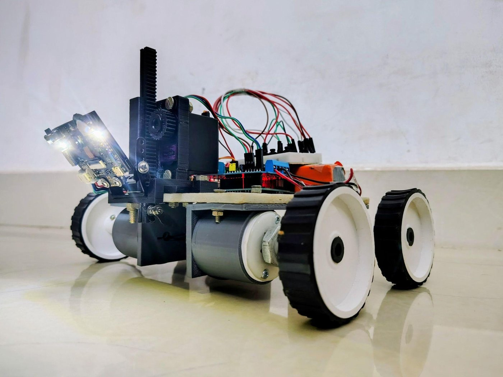

# Interdisciplinary projects

  
   Smart automated cutter prototype: four-wheeled Arduino robot with a HuskyLens camera and a servo-raised blade.

| Project | What it is |
|---|---|
| [smart-automated-cutter](smart-automated-cutter/) | Four-wheeled Arduino robot that follows a drawn line with a HuskyLens camera and drags a blade along it (team project; see the README for my role and the limits of the results). |
