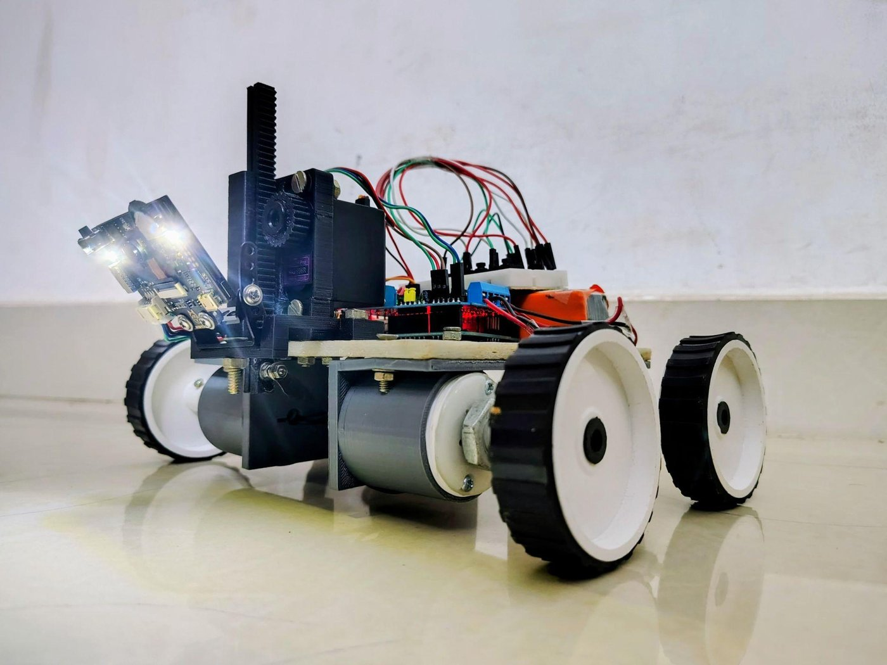
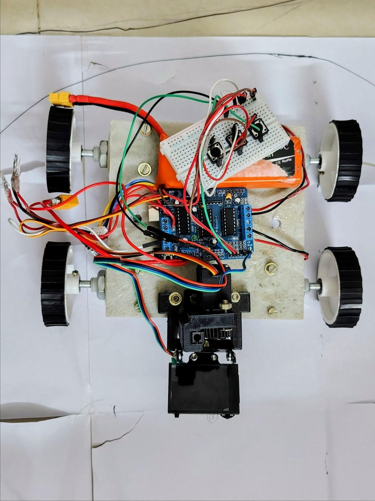
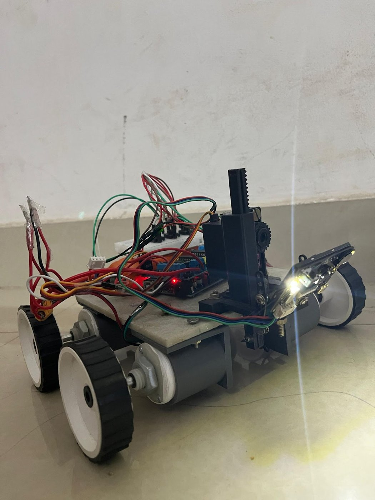
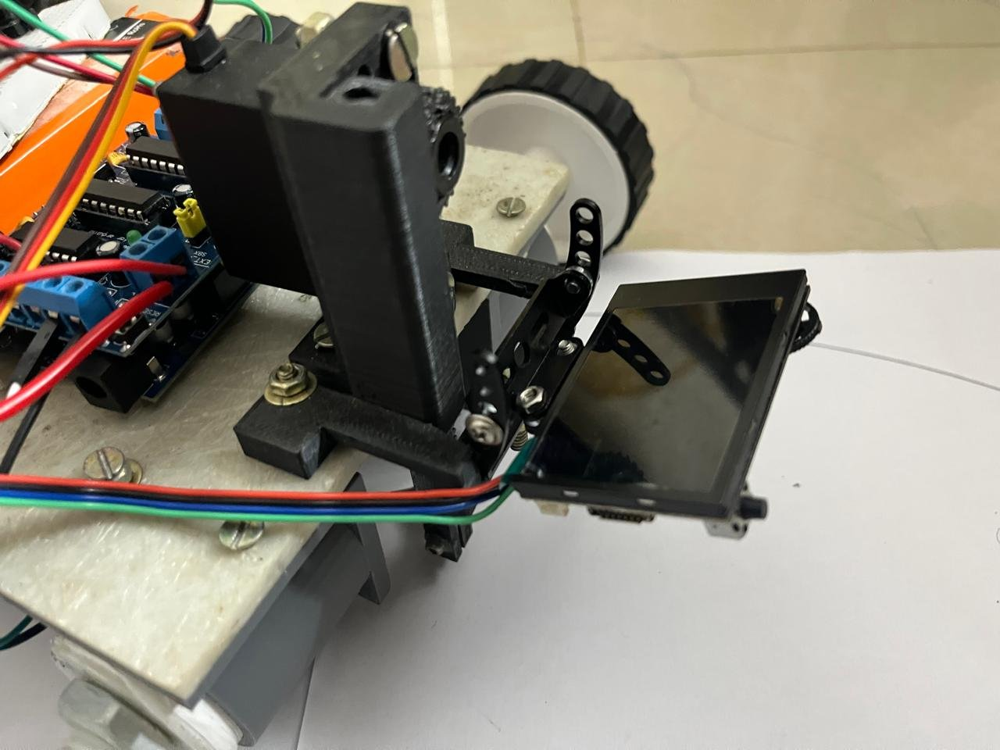
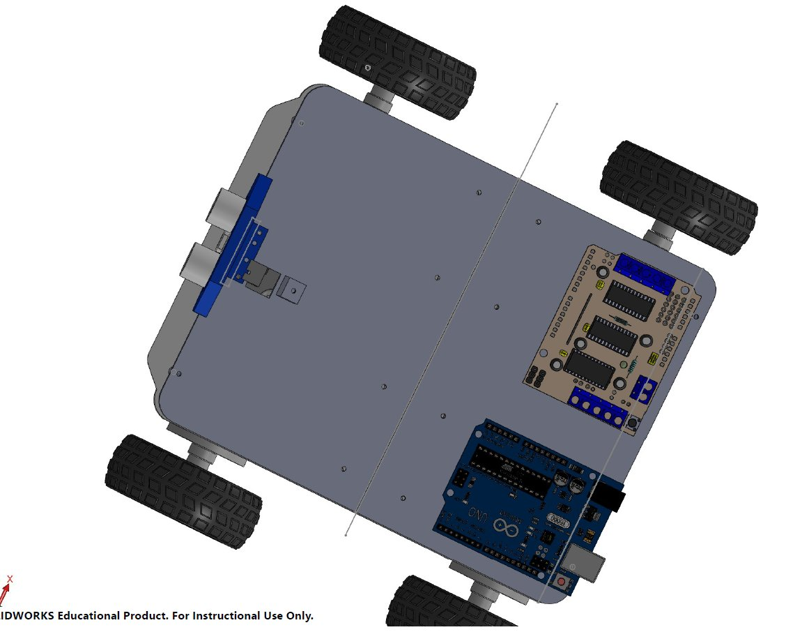
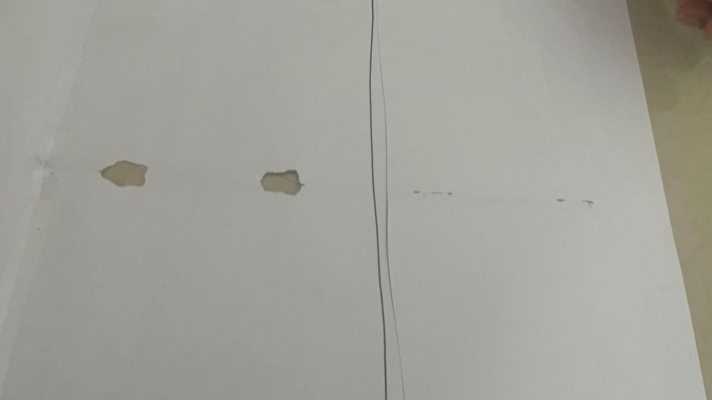

# Smart Automated Cutter

A small four-wheeled robot that follows a line drawn on paper using a HuskyLens AI camera and drags a blade along it. An Arduino Uno runs a proportional steering loop, and a servo with a rack-and-pinion mechanism raises and lowers the blade.

| | |
|---|---|
| **Status** | Working prototype, demonstrated on paper. |
| **Type** | Team project, 7 members (Team 15), IIITDM Kancheepuram |
| **Report date** | April 2025 (design report exported 18 Apr 2025) |
| **My contribution (Varun)** | CAD, firmware, and calibration of the Kp/Ki/Kd gains (author-stated). Tuning values and results not yet recorded; see [docs/status-and-resume.md](docs/status-and-resume.md). |
| **Firmware** | [firmware/smart_cutter/smart_cutter.ino](firmware/smart_cutter/smart_cutter.ino) (transcribed from the report, not re-compiled) |



## Gallery
<table>
<tr>
<td width="33%"><br><sub>Top view: Arduino with motor shield, wiring, battery, four wheels and the front mechanism.</sub></td>
<td width="33%"><br><sub>Rear angle: the rack-and-pinion lift and the HuskyLens camera at the front.</sub></td>
<td width="33%"><br><sub>Close-up of the front mechanism with the HuskyLens camera.</sub></td>
</tr>
<tr>
<td><br><sub>CAD top view of the assembly (SolidWorks Educational watermark visible).</sub></td>
<td colspan="2"><br><sub>Result photo: a cut line on paper. No path-deviation measurement was recorded.</sub></td>
</tr>
</table>

## Problem
Cutting sheets by hand along a drawn path is imprecise, and errors accumulate. CNC and laser cutters are precise but costly and need CAD input. The goal was a cheap, compact, vision-guided cutter for small sheets (A4-A3) that follows a pre-drawn line, with adjustable blade depth for layered media.

## Approach
1. **Stage I** - hand-sized portable cutter with a smooth rotating blade. Dropped: sheet slippage, battery drain, and weight/space constraints.
2. **Stage II** - 4-wheel chassis on an 18 x 16 cm acrylic plate, with 3D-printed holders for the gear motors and the HuskyLens. Simplified from an earlier fully-engraved design because in-house printing was limited to parts under 15 cm.
3. **Stage III (final)** - Colour and IR sensors were tried first but could not pick out the thin line. The report quantifies this for IR: it needs a line of at least 6.5 mm, while the target line is about 0.4 mm. The team switched to the HuskyLens (Kendryte K210), whose on-board AI vision line-tracking mode handles thin lines. 

## How it works
```
HuskyLens (I2C) --line x-position--> Arduino Uno --PWM--> L293D shield --> 4 DC gear motors
                                         |
   3 pushbuttons (A0, A1, A2) -----------+--> MG996R servo (D9) --> rack & pinion --> blade height
```
1. Startup: motors, servo and HuskyLens initialised; HuskyLens set to line tracking.
2. Blade height: user holds a button to drive the servo, then presses a third button to start.
3. Run loop: `error = line_x - 160` (frame is 320 px wide) -> controller correction -> differential left/right speeds. No line detected -> motors stop.

Details: [docs/design.md](docs/design.md)

## Results (what is actually shown)
- The robot followed a drawn line using HuskyLens input and a cut line is visible on paper ([image](images/results/cut-on-paper.jpg)).

## Repository layout
```
firmware/smart_cutter/   Arduino sketch
docs/design.md           Problem, design decisions, components, mechanics
docs/code-review.md      Issues found in the firmware + suggested fixes
docs/status-and-resume.md  Verified vs unverified claims, open questions, draft resume points
images/cad|prototype|results
```

## Team
Varun Kumar R, Soureesh Patanala, Satya Prakash, DVVS Prajay, Mani Krishna, A Akshith Reddy, Dhamodhar Nama.

## Building the firmware
Arduino IDE, board: Arduino Uno. Install libraries: *Adafruit Motor Shield V1* (provides `AFMotor.h`), *HUSKYLENS* (DFRobot). 
